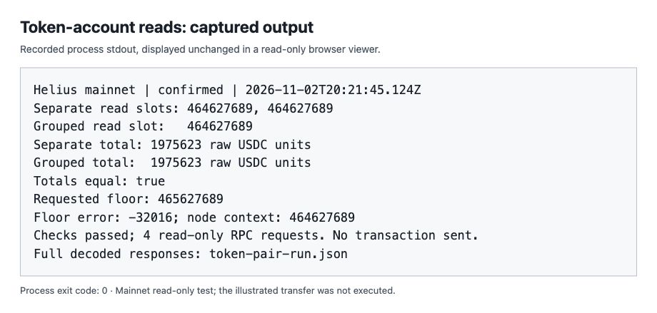

# Solana RPC reads: one calculation, one account view

A small, runnable study of `getAccountInfo`, `getMultipleAccounts`, `context.slot` and `minContextSlot`, using Helius mainnet.

Read the [article](article.md) for the explanation and diagrams. The [source notes](source-notes.md) connect its claims to Solana documentation and a pinned Agave implementation.

## Run

You need Git, Node.js 20 or later, and a [Helius API key](https://dashboard.helius.dev/). The recorded runs used Node.js 24.22.1. No npm install, wallet or token funding is required.

```sh
git clone https://github.com/zeeshan8281/solana-rpc-read-consistency.git
cd solana-rpc-read-consistency
export HELIUS_API_KEY='YOUR_API_KEY'
node code/read-token-pair.mjs
```

The script makes four read-only requests:

1. Read public USDC token account A with `getAccountInfo`.
2. Read account B the same way.
3. Read both with one `getMultipleAccounts` request.
4. Request a context far ahead of the grouped read and assert error `-32016`.

All reads use `confirmed` commitment. The script checks the token program, mint, decimals and integer-string amounts, adds them with `BigInt`, and saves the decoded requests and responses to `token-pair-run.json` in the current directory. A successful run exits 0. No transaction is signed or sent. Requests use your Helius account's RPC allowance.

**Equal totals are a valid result.** This program inspects response contexts; it does not force a transfer or reproduce the hypothetical mixed total in the article. These public accounts may have different owners and unrelated activity. A difference between totals would need investigation too.

Each run replaces the generated `token-pair-run.json` on success or `failed-requests.json` on failure. Copy a generated file before rerunning if you need to retain it. The checked-in evidence has separate directories and is not overwritten by the command above. A failed run may leave an older success file in place: check the exit status and timestamp.

## Recorded results

These are actual captured Helius mainnet responses, not expected-output fixtures. Your slots, balances and timestamps will differ.

| Run (UTC) | Separate contexts | Grouped context | Both totals, raw USDC units | Floor error | Exit |
|---|---|---|---|---|---|
| [2026-11-02 20:21:45](evidence/article-run/token-pair-run.json) | 464627689 / 464627689 | 464627689 | 1975623 | -32016 | 0 |
| [2026-11-02 20:47:28](evidence/review-run/token-pair-run.json) | 464634887 / 464634887 | 464634888 | 1975623 | -32016 | 0 |

USDC has six decimals, so 1975623 raw units is 1.975623 USDC. Both runs made four RPC requests and produced empty stderr. The second run also illustrates that different evaluation slots can return the same balances.

Each evidence directory includes `stdout.txt`, `stderr.txt`, `execution.json` and `token-pair-run.json`. The execution manifest records the source SHA-256. The article's original source is preserved at [evidence/article-run/source.mjs](evidence/article-run/source.mjs). The current [code/read-token-pair.mjs](code/read-token-pair.mjs) adds an explicit amount-string check and preserves the original error if saving failure logs fails; `review-run` validates that revision. Do not treat the original screenshot as evidence of the revised source.



This is a real browser screenshot of a read-only viewer displaying saved process stdout. It is not a native Terminal screenshot. [The viewer](evidence/article-run/viewer.html) and [captured browser text](evidence/article-run/browser-text.txt) are included; the latter matches `stdout.txt` byte-for-byte. The two other figures are labeled conceptual diagrams, with editable SVGs beside the PNGs.

[Error-path evidence](evidence/error-path-validation/execution.json) records a separate actual Helius request with a deliberately invalid credential while the log destination was occupied by a directory. The script reported the HTTP rejection and the log-save failure, then exited 1. This checks failure handling, not account-read correctness.

## If a run fails

- Missing key: set `HELIUS_API_KEY`. Do not commit it; `.env` files and generated root-level logs are ignored.
- HTTP rejection or timeout: check your key, network and Helius quota. Each request times out after 15 seconds; the example does not implement retries.
- Missing or unexpected account: the two public sample accounts may close or change. Replace the two addresses in the script with existing **classic SPL USDC token-account addresses**, keeping the mainnet mint. Wallet and mint addresses are not substitutes.
- Unable to save output: run in a writable directory with free disk space. Errors still produce a nonzero exit status.

## What this study establishes

The live calls show the returned account data, contexts and minimum-slot rejection for the recorded runs. The explanation of why grouping matters comes from the pinned Agave handlers and Bank lifecycle in the source notes.

The study does not recreate a controlled transfer, establish how often mixed totals occur, benchmark latency, or verify which Agave revision Helius deploys. The frozen-view explanation applies to confirmed/finalized reads in the inspected implementation; it must not be extended blindly to a mutable processed Bank. A grouped read accepts at most 100 addresses and cannot reserve balances for a future transaction.

Responses are decoded JSON rather than raw HTTP wire captures. Token amount strings remain exact; unrelated large numeric JSON fields can be rounded by JavaScript parsing. Only Node.js 24.22.1 was executed for these records; the Node.js 20 minimum is based on the standard APIs used.
