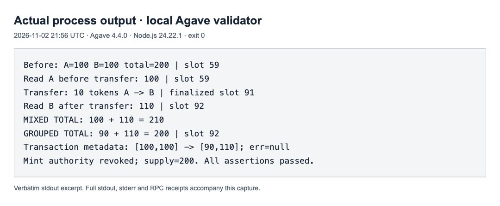

# Solana RPC reads: one calculation, one account view

A runnable study of `getAccountInfo`, `getMultipleAccounts`, `context.slot` and `minContextSlot`.

**A real controlled transfer reproduces the wrong total: 210 from separate reads, versus 200 from a grouped read.** The recorded reproduction ran on a local Agave validator. Separate Helius mainnet checks inspect response contexts and minimum-slot rejection. The networks and evidence are kept explicit below.

Read the [article](article.md) for the explanation and diagrams. The [source notes](source-notes.md) connect its claims to primary documentation and Agave source.

## Run

You need Git, Node.js 22 or later, and `solana-test-validator` from the [official Agave release tools](https://github.com/anza-xyz/agave/releases/tag/v4.4.0). The actual runs used Node.js 24.22.1 and Agave 4.4.0 on macOS ARM64. Other versions/platforms have not been executed for this reproduction.

```sh
git clone https://github.com/zeeshan8281/solana-rpc-read-consistency.git
cd solana-rpc-read-consistency
npm ci --ignore-scripts
solana-test-validator --ledger .local-validator/ledger \
  --bind-address 127.0.0.1 --rpc-port 8899 --quiet
```

Leave that validator running. In a second terminal, from the repository directory:

```sh
npm run reproduce -- --local
```

The script uses only `http://127.0.0.1:8899` in local mode. No Helius key, mainnet funds or external faucet is needed. It creates a private test wallet and obtains local test SOL. It then:

1. Creates a zero-decimal classic SPL mint and two token accounts owned by the wallet; mints 100 to each and revokes mint authority in one setup transaction.
2. Reads A with `finalized` commitment.
3. Signs and sends a real transfer of 10 tokens from A to B, then waits for finalization.
4. Reads B independently and reads A/B together. It asserts the mixed total is 210 and the grouped total is 200.
5. Fetches the finalized transaction receipt, maps token-balance entries through `accountIndex`, and asserts `[100,100]` changed to `[90,110]` with `err: null`.

The transfer is deliberately placed between reads. This demonstrates an application combining two valid states; it does not measure how often production applications do that. Mint authority is revoked to keep the experiment’s supply fixed; no further activity is scheduled. The SOL fee is separate from the token total.

Each run writes decoded RPC requests/responses and metadata into its own timestamped `runs/` directory. Private payer files, local ledger, dependencies and generated logs are Git-ignored. Keep the private payer file private even though it holds only test assets. Stop the validator with Ctrl-C after testing; rerunning without resetting its ledger reuses the local payer and creates a fresh mint/account pair.

The pinned SDK may print `bigint: Failed to load bindings, pure JS will be used`. Both recorded executions emitted that warning and still passed. The stderr files preserve it. No native rebuild is required for the tested path.

## Controlled results

| Recorded run (UTC) | A read | Transfer execution slot | B read | Grouped read | Mixed / grouped totals | Exit |
|---|---|---|---|---|---|---|
| [2026-11-02 21:56:44](evidence/controlled-local-run/controlled-run.json) | 100 @ 59 | 91 | 110 @ 92 | [90,110] @ 92 | 210 / 200 | 0 |
| [2026-11-02 22:11:39](evidence/controlled-clean-install/controlled-run.json) | 100 @ 1888 | 1920 | 110 @ 1920 | [90,110] @ 1920 | 210 / 200 | 0 |

Both are actual signed executions on the local validator. The second used a new directory, a clean `npm ci`, the exact source and lockfile, and a fresh wallet/mint/pair. Immediately afterward, separate Python RPC calls fetched both finalized receipts and checked the final pair. Those [independent responses](evidence/controlled-clean-install/independent-verification.json) are included.



This is a genuine browser screenshot of a read-only viewer showing captured stdout, not a native Terminal screenshot. The [viewer](evidence/controlled-local-run/viewer.html), [screenshot text](evidence/controlled-local-run/browser-text.txt), [verbatim excerpt](evidence/controlled-local-run/stdout-excerpt.txt), full stdout, stderr and execution manifest are included. Browser text was checked byte-for-byte against the saved excerpt. The full stdout is also present in the viewer.

The first run’s [source snapshot](evidence/controlled-local-run/source.mjs) matches its recorded SHA-256. Both manifests also record the dependency lockfile hash. The macOS ARM64 Agave archive was verified against the release asset SHA-256 `7f54760a17ccc51b9aee2e019ef1f841a06edfaa8104ba30f94a877ceec0e8e0` before execution.

**Local signatures are not public explorer proof.** They identify transactions on this local ledger and will not resolve on devnet or mainnet explorers. The script saves receipts during the run because the test validator can prune older blocks. A later lookup of the first run’s transfer returned null after pruning; its [follow-up state check](evidence/controlled-local-run/follow-up-state.json) still returned 90/110. The original receipt remains in the captured run JSON. Rerun the study to create your own independently inspectable local ledger.

## Run the Helius read-only check

```sh
export HELIUS_API_KEY='YOUR_API_KEY'
node code/read-token-pair.mjs
```

This dependency-free script makes four requests to Helius mainnet: separate reads of two public USDC token accounts, one grouped read, and a deliberately far-ahead context floor. It sends no transactions and uses your Helius RPC allowance. Its `confirmed` reads and six-decimal USDC amounts are separate from the controlled zero-decimal local experiment. Equal totals are a valid result; these public accounts can receive unrelated activity, so a difference alone would not prove the conserved-pair failure.

It overwrites root-level `token-pair-run.json` on success or `failed-requests.json` on failure. A failed run can leave an older success file; check timestamps and exit status. Copy generated logs before rerunning if needed. Checked-in evidence directories are never overwritten by this script.

## Separate Helius mainnet checks

These are actual captured Helius mainnet responses, not expected-output fixtures. Your slots and timestamps will differ; balances may stay the same.

| Run (UTC) | Separate contexts | Grouped context | Both totals, raw USDC units | Floor error | Exit |
|---|---|---|---|---|---|
| [2026-11-02 20:21:45](evidence/article-run/token-pair-run.json) | 464627689 / 464627689 | 464627689 | 1975623 | -32016 | 0 |
| [2026-11-02 20:47:28](evidence/review-run/token-pair-run.json) | 464634887 / 464634887 | 464634888 | 1975623 | -32016 | 0 |
| [2026-11-02 20:53:42](evidence/clean-clone-run/token-pair-run.json) | 464636657 / 464636657 | 464636658 | 1975623 | -32016 | 0 |

USDC has six decimals, so 1975623 raw units is 1.975623 USDC. All three runs made four RPC requests and produced empty stderr. The second run also illustrates that different evaluation slots can return the same balances.

Each evidence directory includes `stdout.txt`, `stderr.txt`, `execution.json` and `token-pair-run.json`. The execution manifest records the source SHA-256. The article's original source is preserved at [evidence/article-run/source.mjs](evidence/article-run/source.mjs). The current [code/read-token-pair.mjs](code/read-token-pair.mjs) adds an explicit amount-string check and preserves the original error if saving failure logs fails; `review-run` validates that revision. Do not treat the original screenshot as evidence of the revised source.

The third run used the README command in a fresh clone of the public repository. Its manifest records the tested commit; its source matches the revised script byte-for-byte. Generated output remained ignored by Git.


This is a real browser screenshot of a read-only viewer displaying saved process stdout. It is not a native Terminal screenshot. [The viewer](evidence/article-run/viewer.html) and [captured browser text](evidence/article-run/browser-text.txt) are included; the latter matches `stdout.txt` byte-for-byte. The first diagram now uses the measured local result. The minimum-slot diagram remains conceptual; editable SVGs accompany both.

[Error-path evidence](evidence/error-path-validation/execution.json) records a separate actual Helius request with a deliberately invalid credential while the log destination was occupied by a directory. The script reported the HTTP rejection and the log-save failure, then exited 1. This checks failure handling, not account-read correctness.

## Optional devnet mode: funding required

`npm run reproduce` uses the Helius devnet endpoint with `HELIUS_API_KEY` and checks the devnet genesis hash before creating accounts or sending transactions. The wallet is stored in ignored `.devnet/payer.json`; its public address is printed. A minimum 0.01 devnet SOL balance avoids the script’s airdrop step. This is test SOL only.

This mode has **not completed end to end** in the recorded study. Helius airdrop attempts returned HTTP 500; the public RPC faucet returned HTTP 410 (“faucet is closed”). The proof-of-work client also failed at its prerequisite airdrop. Do not interpret the local results as devnet execution. Public explorer proof remains dependent on funding a public test-network run.

## Failure handling and scope

- Local connection refused: start the validator on 127.0.0.1:8899 and keep it running.
- A submitted transaction times out: inspect the printed signature and saved `pending-requests.json` before rerunning. It may have landed. A rerun creates a new mint/pair rather than retrying that same transfer.
- Invalid/missing account, RPC error or unexpected balance: the script fails and saves failure records instead of fabricating a zero balance. Inspect its nonzero exit status.
- Failure to save logs: stderr reports the error; use a writable directory with free space.
- Helius read-only failures: check key/quota and whether the public sample token accounts still exist.

The reproduction proves the deliberately arranged execution/read order and its observed totals. It does not measure provider latency or incident frequency, establish Helius’s deployed Agave revision, or test every commitment level. The source-based frozen-view explanation concerns confirmed/finalized reads; processed state can still change. Grouping accepts at most 100 addresses and cannot reserve balances for a later transaction.

Responses are decoded JSON, not raw HTTP wire captures. Token amount strings remain exact; unrelated very large numeric JSON fields may be rounded by ordinary JavaScript parsing. Only the stated Node.js and Agave versions were executed for these records.
