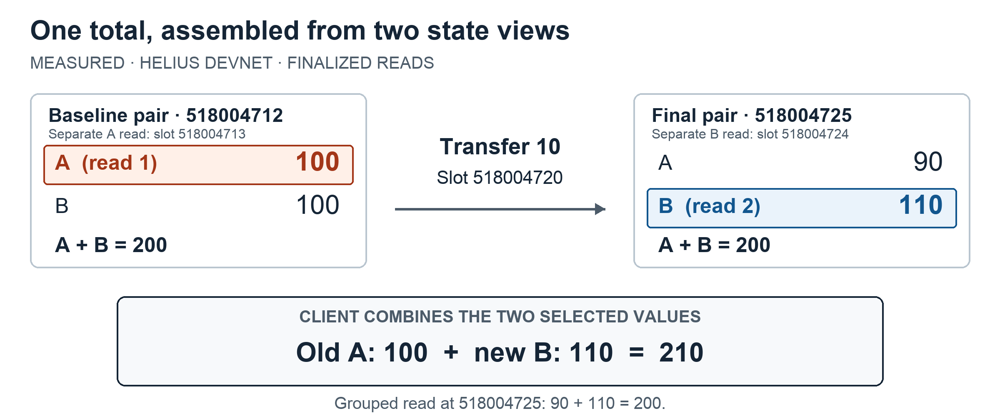
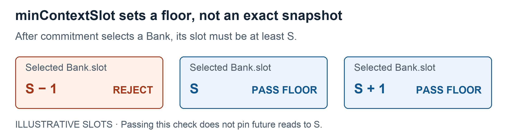
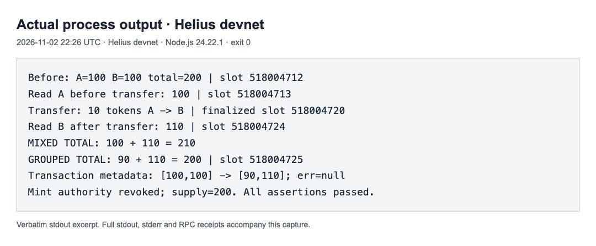

# When two Solana RPC reads give you the wrong total

Reading related token accounts correctly with Helius RPC

A treasury dashboard tracks a token across two accounts. Each holds 100 tokens. Someone transfers 10 from account A to account B, leaving 90 and 110. The total is still 200.

Now refresh the dashboard. Its first RPC call reads A before the transfer: 100. Its second call reads B after the transfer: 110. Both requests succeed. The dashboard displays 210.

The experiment below reproduces this through Helius RPC on Solana devnet. The script uses a Helius endpoint for account reads, signed transactions and receipt checks. One wallet controls both accounts, holding the same classic SPL token with zero decimals. There are no other token movements; devnet SOL pays the fee. The responses and public transaction receipt are saved alongside the code. How did two valid reads produce a total that neither complete state contains?

Table of contents:

- [Each request chooses a view](#each-request-chooses-a-view)
- [Read the related accounts together](#read-the-related-accounts-together)
- [Keep the context beside the value](#keep-the-context-beside-the-value)
- [A minimum slot does not pin a snapshot](#a-minimum-slot-does-not-pin-a-snapshot)
- [Reproduce it with Helius RPC](#reproduce-it-with-helius-rpc)
- [Where the grouped read stops helping](#where-the-grouped-read-stops-helping)

---

## Each request chooses a view

Solana [transactions execute atomically](https://solana.com/docs/core/transactions). The transfer changes both token balances together. Our dashboard has sampled complete states on opposite sides of that change; it has not caught half an executed transfer.



Figure 1. The complete pairs were read at slots 518004712 and 518004725. The highlighted A and B values came from separate reads at 518004713 and 518004724, around the transfer in slot 518004720.

Each account request asks the RPC node to choose a view of the chain. In Agave, the Solana validator client referenced here, that view is called a Bank. The [getAccountInfo handler](https://github.com/anza-xyz/agave/blob/a1468974d804b413285d87030f20bd40ae22ffaa/rpc/src/rpc.rs#L541-L568) selects one, reads the account and returns its value.

The request's commitment tells the node which view it may use. It does not bind your next call to the same view. Two requests can both use `confirmed` while the second selects a later state. Changing both to `finalized` does not pin the first observation either: the finalized view can advance between calls.

This is why increasing commitment alone does not fix the dashboard. The application needs the two balances to belong to one selected state. It currently asks the node to make that selection twice.

The distinction matters whenever one result depends on several accounts. A list of unrelated balances may tolerate separate observations. For a total, ratio or invariant involving accounts that can change together, decide whether the calculation needs one state view.

## Read the related accounts together

Through your Helius endpoint, [getMultipleAccounts](https://www.helius.dev/docs/api-reference/rpc/http/getmultipleaccounts) lets you request related accounts in one call. The response preserves their order and includes one context for the entire array. The [grouped handler](https://github.com/anza-xyz/agave/blob/a1468974d804b413285d87030f20bd40ae22ffaa/rpc/src/rpc.rs#L569-L599) selects its view once before reading the list.

At confirmed or finalized commitment, the selected Bank is [frozen](https://github.com/anza-xyz/agave/blob/a1468974d804b413285d87030f20bd40ae22ffaa/runtime/src/bank.rs#L1-L31): it has finished processing transactions for its slot. Its account state stays fixed while the request reads the list. For our treasury, the pair is either 100 and 100, or 90 and 110. Both add to 200.

The [controlled example](https://github.com/zeeshan8281/solana-rpc-read-consistency/blob/main/code/reproduce-mixed-total.mjs) keeps setup, signing and validation in the repository. After finalizing the transfer, it makes this grouped request (line-wrapped here):

```javascript
const grouped = await rpc('getMultipleAccounts', [
  addresses, { ...config, minContextSlot: transfer.slot },
]);
```

Here, `addresses` contains the two token-account addresses; `config` requests `finalized` commitment and `jsonParsed` encoding. The floor prevents a view older than the transfer slot. Parsing makes fields readable without changing the read boundary. The helper rejects RPC errors and validates each account’s program, mint, owner and decimals. It adds raw integer-string amounts with `BigInt`; a missing account fails instead of becoming zero.

Use token-account addresses here. A wallet address identifies the wallet, and a mint address identifies the token; neither is a substitute for the accounts holding the balances. A wallet can have [multiple token accounts for one mint](https://solana.com/docs/tokens). Keep the response entries attached to their input addresses when caching or displaying them, since a correct list read can still become a wrong calculation if the application mixes up its entries.

Use `confirmed` or `finalized` for this pattern. At `processed` commitment, the selected state can still change while the request reads the accounts. The source note below explains that distinction.

Putting two `getAccountInfo` calls into one HTTP batch is a different operation. The [JSON-RPC specification](https://www.jsonrpc.org/specification#batch) allows batch members to run concurrently and in any order. One HTTP envelope does not make those method invocations share a state view. Likewise, starting two promises at the same time does not establish a shared observation.

## Keep the context beside the value

The grouped response has a `context.slot` alongside its array of values. This is the [slot of the selected state view](https://github.com/anza-xyz/agave/blob/a1468974d804b413285d87030f20bd40ae22ffaa/rpc/src/rpc.rs#L148-L153). It tells you where the read was evaluated.

It is not the time each account last changed. Account A might remain untouched for many slots while reads of it return increasingly recent context slots. An oracle account can also belong to the selected view while its own published price is old. Check the program's update fields when the age of the underlying data matters.

Keep the context when storing or passing along a combined result. A helper that returns only `result.value` discards information you may need when explaining why two refreshes differ. When diagnosing a total, record the account addresses and commitment too, so you can tell which observations the application combined.

Comparing slots helps identify separate evaluation contexts. Matching slot numbers from independent requests, especially across providers, should not replace a grouped read contract: a slot number alone does not identify a fork or prove that a mutable view stayed unchanged.

## A minimum slot does not pin a snapshot

Suppose the first read returned slot S. It is tempting to set `minContextSlot: S` on the second and expect both values to come from S.

The parameter sets a lower bound. The node [selects a view using commitment, then checks its slot against the minimum](https://github.com/anza-xyz/agave/blob/a1468974d804b413285d87030f20bd40ae22ffaa/rpc/src/rpc.rs#L278-L293). A later context can pass that check. The request does not select an exact historical state or open a persistent read session.



Figure 2. A selected slot below S fails the floor check. S and later slots can pass it; the account lookup can still fail for other reasons.

For the treasury, this means the second call may still read B after the transfer. The floor rejects an older evaluation context, but it cannot make two separate requests share the earlier state. It also supplies no fork-continuity guarantee.

A separate [read-only Helius example](https://github.com/zeeshan8281/solana-rpc-read-consistency/blob/main/code/read-token-pair.mjs) sets a floor far ahead of the current view to make the rejection visible:

```javascript
const floor = grouped.result.context.slot + 1_000_000;
const future = await rpc('getAccountInfo', [accountA, {
  ...config, minContextSlot: floor,
}]);
```

Use this parameter when an operation requires a context at least as recent as an observed slot. If the node cannot meet that floor, the application must retry later or fail the operation. The large offset here exists only to make the rejection visible.

## Reproduce it with Helius RPC

The reproduction creates a fresh mint and two ordinary token accounts, puts 100 tokens in each, and revokes mint authority. It reads A, sends 10 tokens from A to B, waits for finalization, then reads B. Finally, it reads the pair together and checks the transfer receipt. Both setup and transfer execute on devnet.

Follow the [repository setup](https://github.com/zeeshan8281/solana-rpc-read-consistency#run). You need Node.js 22 or later, a Helius API key and at least 0.01 test-only devnet SOL in the script's wallet. The script builds the `https://devnet.helius-rpc.com/` endpoint from your key and sends its RPC requests there. From the repository:

```shell
npm ci --ignore-scripts
export HELIUS_API_KEY='YOUR_API_KEY'
npm run reproduce
```

The captured run began on 2 November 2026 at 22:26 UTC through Helius devnet, using Node.js 24.22.1. A returned 100 at slot 518004713. The transfer executed in slot 518004720; after finalization, B returned 110 at 518004724. The mixed total was 210. The grouped read at 518004725 returned 90 and 110: total 200. The process exited 0.

The 210 came from the client's addition of balances read at different times. Helius returned the individual balances the script requested. The grouped request gave the client both balances from one selected view.



Screenshot. Verbatim stdout excerpt displayed in a browser log viewer. Full stdout, stderr and decoded RPC responses are saved in the repository.

Verify the [setup transaction](https://explorer.solana.com/tx/MgGWaBb3y9AahCjocwMfUgmANDScnx6Y4Rh5FFFkAS9E8eGTE9xz1yVLvFwcvLmJKeg9TG97QR3fXfJ7kbEeEW3?cluster=devnet) and [10-token transfer](https://explorer.solana.com/tx/3nr1sD9rqoRSiWUTg4Du5KfQtDGf3BPymGfJMJ2kMduV79cu96yJpEeeWJqqhohPx2Z7uffmss9tQ9Bgd3xmCR2H?cluster=devnet) on Solana Explorer, with Devnet selected. The receipt reports `err: null` and balances changing from `[100,100]` to `[90,110]`; the script maps entries to addresses using `accountIndex`. Independent public-RPC queries confirmed both receipts. The explorer verifies the transfer; the [captured responses](https://github.com/zeeshan8281/solana-rpc-read-consistency/blob/main/evidence/controlled-devnet-run/controlled-run.json) establish the read order and mixed total. That ordering is deliberate, so this demonstrates the failure mode rather than its production frequency.

## Where the grouped read stops helping

The method accepts up to 100 addresses. Splitting 250 accounts into several calls creates several read boundaries again. A minimum slot on later chunks does not turn them into one historical snapshot. Concatenating those arrays cannot establish that all 250 values came from one view.

There is also a boundary between reading and acting. A coherent balance observation cannot reserve those balances for a later transaction. The onchain program must check any condition that needs to hold when the transaction executes.

For the two-account dashboard, the practical change is small: request the related accounts together, validate both values, and carry their context with the total. The choice of RPC method determines whether that total starts from one selected view.

<details>
<summary>Source note: why commitment matters for a grouped read</summary>

The implementation links point to a pinned revision of Agave. They explain how the node selects a state view; the experiment does not identify the client build behind the Helius endpoint.

The [confirmed-Bank tracker](https://github.com/anza-xyz/agave/blob/a1468974d804b413285d87030f20bd40ae22ffaa/rpc/src/optimistically_confirmed_bank_tracker.rs#L312-L336) adopts a notified Bank only after it is frozen and its hash matches the notification. A processed Bank can still change while a request holds its reference. This is why the explanation above uses confirmed or finalized reads.

</details>

[Run the complete study on GitHub](https://github.com/zeeshan8281/solana-rpc-read-consistency#run): setup instructions, source code, diagrams and the captured RPC responses are included.
